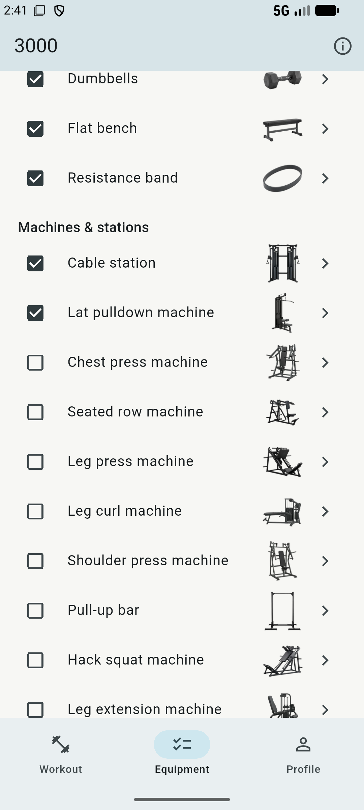
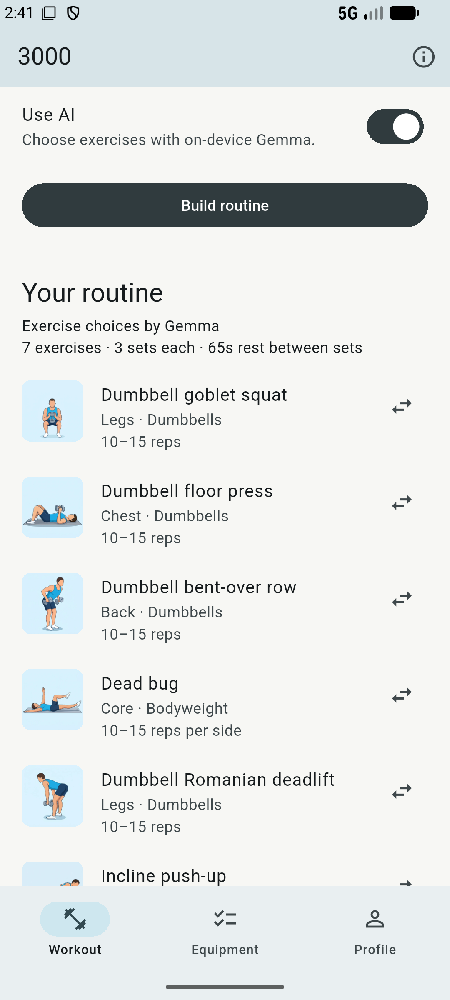
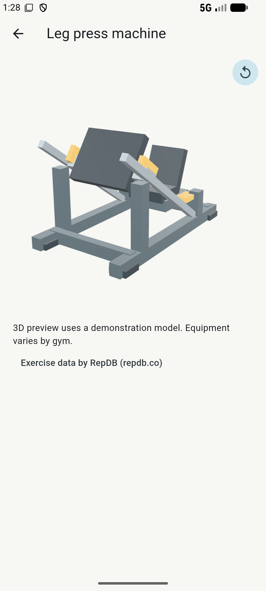
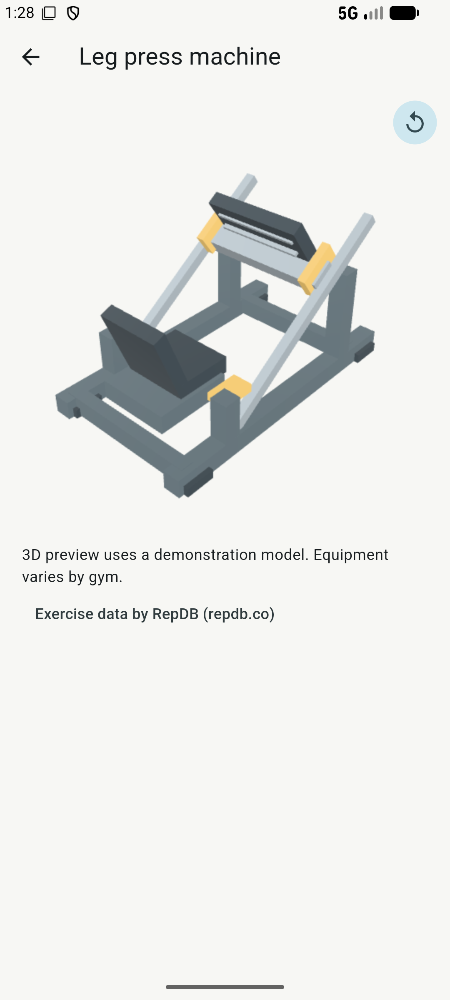

# 3000

3000 is an offline Flutter workout planner. Sign in with **user** for both the ID and password, enter your height and weight, and open **Equipment** to search the catalog and check off what your gym has. **My gym** shows your saved selections and custom equipment. Under **Workout**, choose two to four target areas, an experience level, and a time limit, then tap **Build routine**. **Full body** selects legs, chest, back, and core. Tap a photo to enlarge it or use the swap button to find an available replacement.

The app can build bodyweight routines before you enter any equipment. Use **Add equipment** to save machines by name. Choose an exercise match to include that machine in recommendations, or keep it as an inventory entry. Your profile and equipment are saved on the device. The muscle mass field accepts an optional reading from a body composition assessment.

### Optional AI workout choices

**Use AI** is off by default. On a supported device, turn it on under **Workout** and tap **Download Gemma** for the one-time 2.4 GiB download. Gemma 4 E2B runs locally after the download. It chooses from exercise options that fit the selected areas, available equipment, and existing time budget. The regular builder runs when the toggle is off or Gemma cannot return a valid selection. The model lives in the app cache and may need to be downloaded again if the device clears it.

## Screenshots

| Equipment catalog | Workout with Gemma |
| --- | --- |
|  |  |
| **Leg press demo at the starting angle** | **Leg press demo after dragging** |
|  |  |

Illustration credit for the catalog and workout screenshots. [Exercise data by RepDB (repdb.co)](https://repdb.co/)

## Run on Android

1. Install Flutter and Android Studio. In Android Studio, install the Flutter plugin and set its Flutter SDK path if prompted. This project was developed with Flutter 3.44.8.
2. Run `flutter doctor -v`. If the Android toolchain flags missing command-line tools or licenses, open **Tools > SDK Manager > SDK Tools**, install **Android SDK Command-line Tools (latest)**, and run `flutter doctor --android-licenses`.
3. Open this project folder in Android Studio. In **Tools > Device Manager**, start **Medium Phone**. If you need to create it, choose a Medium Phone hardware profile and install a compatible Android system image.
4. Open `lib/main.dart`, choose the emulator in the device selector, and click **Run**. You can also run these commands from the project folder.

```powershell
flutter pub get
flutter devices
flutter run -d emulator-5554
```

If `flutter devices` shows a different ID, use that ID in the last command. For an installable Android debug APK, run `flutter build apk --debug`. Flutter writes it under `build/app/outputs/flutter-apk/app-debug.apk`.

If the emulator stalls during startup, try **Cold Boot Now** in Device Manager. You can also create a Medium Phone with a stable Android system image or use a physical Android phone with USB debugging enabled. For either device, use its ID from `flutter devices`.

## Run on iOS

On a Mac, install Flutter and Xcode and complete [Flutter's iOS setup](https://docs.flutter.dev/platform-integration/ios/setup). Then open the project folder in a terminal and run the following.

```bash
flutter pub get
open -a Simulator
flutter devices
flutter run -d <iOS-device-id>
```

Replace `<iOS-device-id>` with the simulator ID from `flutter devices`. For a physical iPhone, configure **Runner** signing in Xcode first.

## Run the checks

```text
flutter analyze
flutter test
```

The tests cover mock sign-in, measurement validation and persistence, saved equipment, bodyweight fallback, equipment filtering, workout length, and exercise swaps. On Windows, running widget tests on the host requires the Visual Studio C++ toolchain to build the inference plugin's native code.

To run the AI toggle and fallback tests on Android, start the emulator or connect a phone and run `flutter test integration_test/routine_ai_device_test.dart -d emulator-5554 --no-uninstall`. The flag preserves the app's saved data. These tests use a simulated model response and require no model download. Use the device ID shown by `flutter devices`, then run the main app again with `flutter run`.

## Equipment and image sources

Common machine names in the catalog were cross-checked against [Yash Gym Tabular Dataset by ysakhale](https://huggingface.co/datasets/ysakhale/yash-gym-tabular-dataset), licensed under [CC BY 4.0](https://creativecommons.org/licenses/by/4.0/). The catalog uses its own equipment categories and exercise matches.

To bundle the selected free RepDB stills for offline use, run `flutter pub get` and then `dart tool/fetch_repdb_assets.dart` from the project folder before building. The script downloads only the images used by the app at a pinned revision. The public source tree contains the mappings and script. **Photo credits** includes the required attribution. The Wikimedia Commons photographs serve as fallbacks and retain their [individual credits](assets/commons/ATTRIBUTION.md). [RepDB free-tier license](https://huggingface.co/datasets/RepDB/exercise-dataset/blob/main/LICENSE.md)

## Add a machine 360° view

1. Open `lib/equipment_page.dart` and find the machine's `Equipment` entry. Add `media: MachineMedia(model3dUrl: 'assets/models/machine.glb')`, or use an HTTPS URL serving a self-contained GLB 2.0 file. Use a versioned URL for model updates. Remote GLBs are cached by URL in the device's app cache. An optional `posterUrl` can point to an app asset or an HTTPS image.
2. For a turntable sequence, leave `model3dUrl` empty and pass the images in order through `spinFrames`. Supply 24–36 consistently lit, evenly spaced frames with the front three-quarter angle first. Register any bundled frame directories under Flutter assets in `pubspec.yaml`. A single equipment photo goes in the poster field.
3. From Equipment, tap the chevron beside the machine to verify the detail view and reset. Leg press ships with a small original schematic under [CC0](https://creativecommons.org/publicdomain/zero/1.0/) for development. Replace it with a licensed model of an actual machine when available.

Keep each GLB under 5 MB where possible, with textures at 2048 px or smaller. For example, use `npx @gltf-transform/cli resize input.glb resized.glb --width 2048 --height 2048` followed by `npx @gltf-transform/cli optimize resized.glb machine.glb --compress meshopt`. Use `--compress draco` as an alternative and test compressed assets on the target WebViews. [glTF Transform CLI](https://gltf-transform.dev/cli)

The renderer uses the bundled `model_viewer_plus` WebView library. On Android, Internet permission and cleartext access for loopback allow its local asset server to work. Remote models use HTTPS. iOS enables embedded WebViews and local networking for the same loopback server. Optional model annotations use `MachineHotspot` with positions and normals in model coordinates. AR is off by default. Build with `--dart-define=ENABLE_MACHINE_AR=true` and supply a production HTTPS GLB and an HTTPS USDZ in `iosModelUrl` for Quick Look. Check AR support on physical devices before shipping.

Run the full suite on Android with `flutter test integration_test/app_device_test.dart -d emulator-5554 --no-uninstall` if Windows host tests are blocked by the native C++ toolchain.
